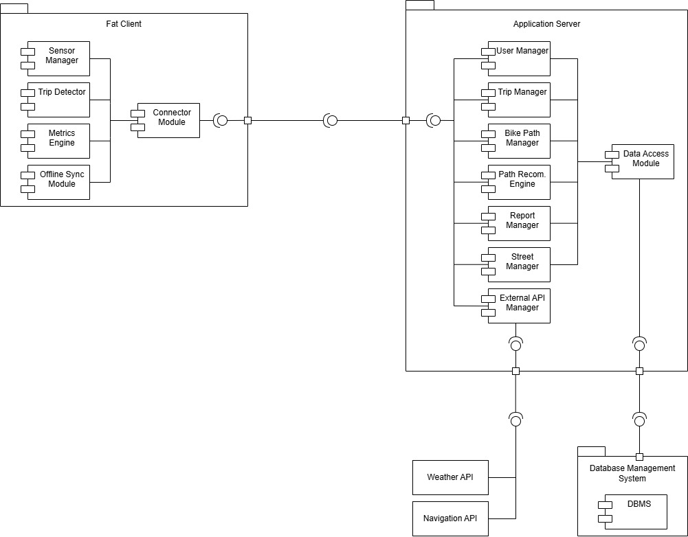
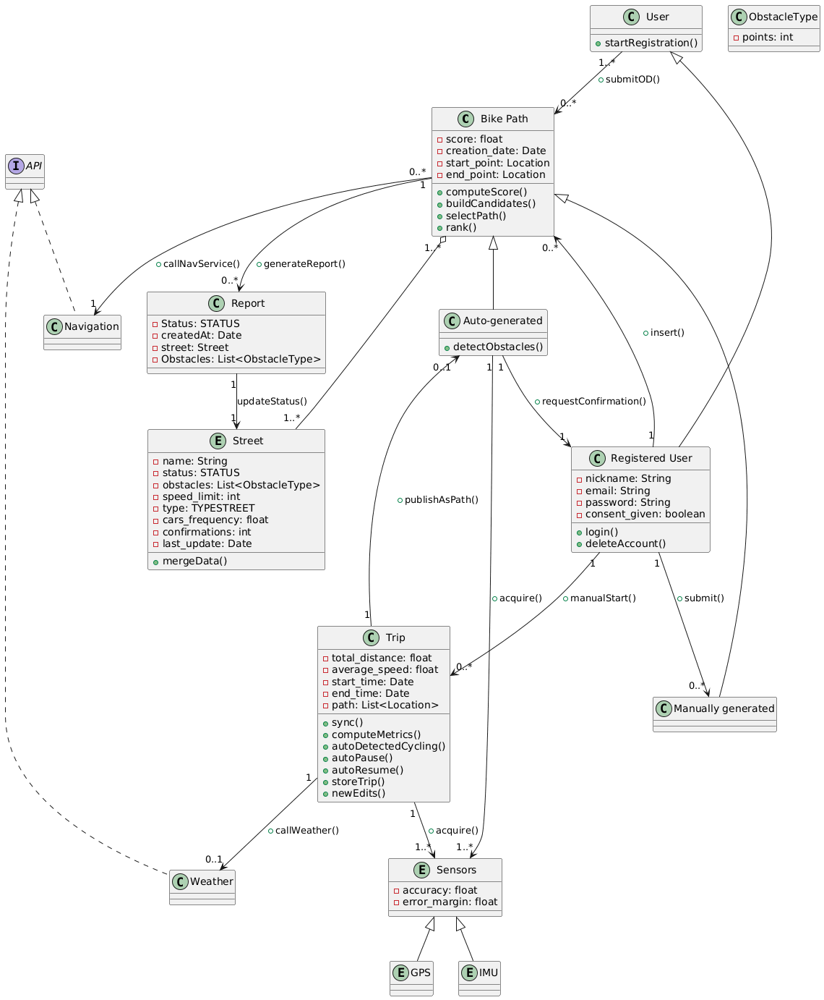

<div align="center">

# Best Bike Paths — System Design & Specification

**A crowdsourced cycling platform designed from the ground up:
requirements engineering, distributed architecture, formal verification, and IoT data pipelines.**

[](DeliveryFolder/)
[](https://www.polimi.it)
[](#)
[](DeliveryFolder/)

</div>

---

## Overview

Best Bike Paths (BBP) is a full-stack mobile platform that enables urban cyclists to **record trips via smartphone sensors (GPS + IMU)**, **crowdsource road condition data**, and **discover optimal cycling routes** ranked by a multi-factor safety score.

This repository contains the complete software engineering specification — from stakeholder analysis through formal verification — developed as the capstone project for the Software Engineering 2 course at Politecnico di Milano (Prof. Elisabetta Di Nitto).

### What makes this project stand out

| Dimension | Detail |
| :--- | :--- |
| **Scale** | ~350 pages of specification across RASD + DD, 160+ commits, 96 person-hours |
| **Architecture** | 3-tier client-server, microservices backend, offline-first fat client |
| **Formal Methods** | Alloy model (~180 LOC) with verified invariants on data merging |
| **Algorithms** | Multi-factor route scoring, reputation-weighted aggregation, edge anomaly detection |
| **Engineering Rigor** | Full UML suite (13 use cases, 8 sequence diagrams, 9 state machines, class + component + deployment diagrams), REST API specification, requirements traceability matrix |

---

## System Architecture

The system follows a **3-tier, microservices-oriented architecture** with a deliberately thick client that offloads sensor processing and supports offline operation.

<div align="center">
  
  <br/>
  <em>Component Diagram — Fat Client ↔ Application Server ↔ DBMS + External APIs</em>
</div>

<br/>

```
┌──────────────────────┐     HTTPS      ┌───────────┐     HTTPS     ┌────────────────────────────────┐
│    Fat Client (MVC)  │ ◄────────────► │    API    │ ◄──────────►  │     Application Server         │
│                      │                │  Gateway  │               │                                │
│  • Sensor Manager    │                │           │               │  • User Manager                │
│  • Trip Detector     │                │  • TLS    │               │  • Trip Manager                │
│  • Metrics Engine    │                │  • Auth   │               │  • Bike Path Manager           │
│  • Offline Sync      │                │  • Rate   │               │  • Path Recommendation Engine  │
│  • Local Storage     │                │    Limit  │               │  • Report Manager              │
│    (SQLite)          │                └───────────┘               │  • Street Manager              │
└──────────────────────┘                                           │  • External API Manager        │
                                                                   │  • Data Access Module          │
                                                                   └────────┬──────────┬────────────┘
                                                                            │          │
                                                                    JDBC/SQL│          │HTTPS
                                                                            ▼          ▼
                                                                   ┌──────────┐  ┌──────────────┐
                                                                   │PostgreSQL│  │ Weather API  │
                                                                   │  (ACID)  │  │Navigation API│
                                                                   └──────────┘  └──────────────┘
```

### Key Architectural Decisions

| Decision | Rationale |
| :--- | :--- |
| **Fat client** | Offloads real-time sensor processing (50 Hz IMU) to the device, reducing server load and enabling offline-first operation |
| **Stateless backend** | Enables horizontal scaling; each request is self-contained with JWT authentication |
| **API Gateway** | Single entry point for TLS termination, rate limiting, load balancing, and request routing |
| **Repository/DAO pattern** | All server components access PostgreSQL through a shared Data Access Module abstraction |
| **Store-and-forward sync** | Trips are recorded locally as JSON, buffered, and auto-synced when connectivity is restored |

---

## Core Algorithms & Data Pipeline

### 1. Crowdsourced Data Merging

The system aggregates road condition reports from multiple users through a **freshness-first, majority-vote** algorithm:

```
1. Collect all reports for a given street
2. Filter to the most recent timestamp (freshness priority)
3. Among same-freshness reports → majority vote on status
4. On ties → select status with lowest penalty points (optimistic bias)
```

Street status uses a penalty-point system: `Optimal (0 pts) → Mediocre (1 pt) → NeedsMaintenance (2 pts)`. Obstacle types are weighted similarly: `Pothole (3 pts) > Bump (2 pts) > GenericObstacle (1 pt)`.

This produces a **self-correcting data layer** where stale reports decay and the crowd converges on ground truth.

### 2. Path Recommendation Engine

Route scoring uses a **multi-criteria weighted formula**:

```
Score(path) = Σ  penalty(street.status) + Σ  penalty(street.obstacles)
              s∈path                      s∈path
```

Lower scores indicate safer routes. The engine:
1. Retrieves candidate paths from DB matching origin/destination
2. Computes composite scores per candidate
3. Ranks by ascending score
4. Returns top-N results (default N = 3)

Each street is also validated against a **Navigation API** for cycling compliance (speed limits, road width, traffic volume, dedicated bike lanes). Non-compliant streets block path publication.

### 3. Edge Anomaly Detection

The mobile client performs real-time road condition sensing at the edge:

- **Accelerometer + Gyroscope** sampled at **50 Hz**; GPS at **1 Hz**
- **Automatic trip detection** from IMU data with auto-pause/resume based on speed thresholds
- Sensor data batched locally and uploaded every **30 seconds**
- Obstacle detection (potholes, bumps) inferred from accelerometer patterns before server upload

---

## Formal Verification with Alloy

The crowdsourced merging logic is formally specified and verified using [Alloy](https://alloytools.org/), a lightweight formal specification language.

### What we modeled

| Signature | Purpose |
| :--- | :--- |
| `User`, `RegisteredUser` | Actor hierarchy |
| `Street`, `BikePath`, `Report` | Core domain with temporal ordering (`util/ordering[Time]`) |
| `Status` → `Optimal \| Mediocre \| NeedsMaintenance` | Street condition with penalty points |
| `ObstacleType` → `Pothole \| Bump \| GenericObstacle` | Obstacle taxonomy with weights |

### Verified invariants

- **`ReportsConsistentWithPaths`** — reports reference only streets within their associated bike path
- **`NoCircularPaths`** — start ≠ end for every path
- **`StatusUpdatedByReports`** — street status always reflects the computed result of the merging algorithm
- **`NonNegativeScore`** — all path scores ≥ 0
- **`ValidPublish`** — every published path contains at least one street

### Verification scenarios

Three scenarios validate the merging algorithm's correctness:

| Scenario | Expected behavior | Result |
| :--- | :--- | :--- |
| Single report updates street | Status follows sole reporter | ✅ Verified |
| Recent vs. old majority | Freshness wins over older consensus | ✅ Verified |
| Conflicting same-timestamp reports | Majority vote resolves; ties favor optimistic status | ✅ Verified |

> The complete Alloy specification is in [`RASD/RASD.tex`](RASD/RASD.tex) (Chapter 4).

---

## UML & Behavioral Modeling

The specification includes comprehensive UML artifacts modeling the system at multiple levels of abstraction:

<details>
<summary><strong>📋 Use Cases (8 total)</strong></summary>

| ID | Use Case | Actor(s) |
| :--- | :--- | :--- |
| UC1 | Register | Unregistered User |
| UC2 | Login | Registered User |
| UC3 | Delete Account | Registered User |
| UC4 | Record Trip | Registered User |
| UC5 | View Past Trips | Registered User |
| UC6 | Insert Bike Path (Manual) | Registered User |
| UC7 | Insert Bike Path (Automatic) | Registered User |
| UC8 | Search Bike Path | All Users |

</details>

<details>
<summary><strong>🔄 State Machines (9 total)</strong></summary>

| State Machine | States | Notable Design |
| :--- | :--- | :--- |
| Account Lifecycle | Unregistered → Registering → Registered → Deleted | Nested composite state for GPS/IMU consent management |
| Trip Recording | Idle → Recording → Completing → Stored → Synced | Auto-pause/resume; offline-first (Stored → Synced) |
| Trip Review & Publication | Reviewing ↔ Annotated → GeneratingPath → Validating → Published/Rejected | Human-in-the-loop review for auto-detected obstacles |
| Weather Enrichment | Pending → Querying → Success/Retry → Failed | Retry with exponential backoff; graceful degradation |
| Bike Path Manual | Draft → ValidatingInput → ConsultNavService → Published/Rejected | Two-stage validation: form + API compliance |
| Bike Path Automatic | Candidate → Detecting → Reviewing ↔ Corrected → Validating → Published | Iterative correction loop |
| External API Evaluation | Preparing → Consulting → PerStreetEvaluation → Ready/Rejected | Composite state for per-street aggregation |
| Origin-to-Destination Query | AwaitingQuery → Collecting → Scoring → ResultsReady | Re-ranking support via fusion updates |
| Merging & Propagation | (models score cascade across dependent paths) | When a street status changes, all paths containing it are recomputed |

</details>

<details>
<summary><strong>📊 Sequence Diagrams (8 runtime views + 8 higher-level)</strong></summary>

Two complementary sets of sequence diagrams:

- **Runtime Views** (component-level): Model interactions between internal modules (Sensor Manager → Trip Detector → Metrics Engine → Connector Module → Managers → Data Access Module → DB)
- **Higher-Level Sequences**: Model interactions between Frontend ↔ Backend ↔ DB ↔ External APIs, including exception handling and SSO flow

Covered scenarios: Registration, Login, Account Deletion, Trip Recording, View Past Trips, Manual/Automatic Bike Path Creation, Bike Path Search.

</details>

### Class Diagram

<div align="center">
  
  <br/>
  <em>Domain Model — Bike Path, Street, Trip, Report, and User entities with sensor and API integrations</em>
</div>

---

## REST API Design

The backend exposes a stateless RESTful interface with JWT authentication:

| Method | Endpoint | Purpose |
| :--- | :--- | :--- |
| `POST` | `/register` | Create user account |
| `POST` | `/login` | Authenticate (returns JWT) |
| `DELETE` | `/account` | Delete user account |
| `POST` | `/trip` | Store a recorded trip (with sensor data + metrics) |
| `GET` | `/trips` | List user's past trips |
| `GET` | `/trip/{id}` | Get trip details |
| `POST` | `/bikepath/manual` | Publish manually-created bike path |
| `POST` | `/bikepath/auto` | Publish auto-generated bike path from trip |
| `GET` | `/path?origin&destination` | Search bike paths (scored + ranked) |
| `PUT` | `/update_preferences` | Update user settings (units, language) |

All endpoints use HTTPS with TLS 1.3. Passwords are hashed with AES-256. Rate limiting is enforced at the API Gateway.

---

## Non-Functional Requirements

| Category | Specification |
| :--- | :--- |
| **Performance** | API response < 2s; client tap ack < 100ms; UI actions < 300ms |
| **Scalability** | ~200K DAU target; 20K concurrent users; stateless horizontal scaling |
| **Availability** | 99.9% uptime SLA; offline-first client; no single points of failure |
| **Security** | TLS 1.3, AES-256 password encryption, GDPR compliance, OAuth/SSO support |
| **Portability** | Android + iOS; cloud-agnostic backend |

---

## Project Deliverables

| Document | Description | Pages |
| :--- | :--- | :--- |
| 📄 [**RASD**](DeliveryFolder/RASD_v1.0.pdf) | Requirements Analysis & Specification Document — goals, requirements, UML, Alloy, UI mockups | ~200 |
| 🏗️ [**DD**](DeliveryFolder/DD_v1.0.pdf) | Design Document — architecture, components, runtime views, API spec, DB schema, testing strategy | ~150 |
| 🎤 [**Presentation**](DeliveryFolder/Presentation_v1.0.pdf) | Project presentation slides | — |

> Source files: [`RASD/`](RASD/) and [`DD/`](DD/) (LaTeX).

---

## Tech Stack

| Layer | Technologies |
| :--- | :--- |
| **Client** | Mobile (Android/iOS), MVC, SQLite, GPS + IMU sensors (50 Hz) |
| **Server** | Microservices, REST/JSON, JWT, API Gateway |
| **Data** | PostgreSQL (ACID), store-and-forward sync |
| **External** | Weather API, Navigation API |
| **Security** | TLS 1.3, AES-256, OAuth/SSO |
| **Verification** | Alloy (formal specification) |
| **Documentation** | LaTeX, PlantUML |

---

Team: Gianluca Di Paola, Simone Controguerra, Matteo Delogu
Course: **Software Engineering 2**, Politecnico di Milano, A.Y. 2025/2026
Supervisor: **Prof. Elisabetta Di Nitto**

---

<div align="center">
  <sub>Awarded maximum grade with honors (30L/30).</sub>
</div>
